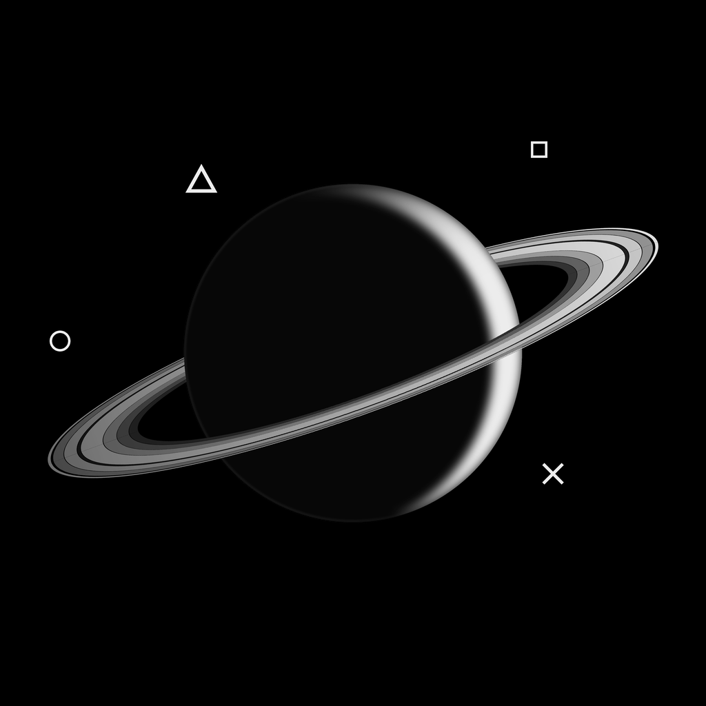

<h1 align="center">SaturnProject</h1>

<b>PS5 Remote Play for Windows with DLSS / FSR 3 frame generation — play your PlayStation 5 on PC at up to 120 fps, even 30 fps games.</b>

DLSS Frame Generation · AMD FSR 3 Frame Generation · 30 → 120 fps · 60 → 120 fps · 4K RTX Video Super Resolution ·
DualSense haptics & adaptive triggers · button remapping · single portable exe · based on chiaki-ng

---

SaturnProject is a free, open source **PlayStation 5 Remote Play client for Windows PCs**. It wakes your PS5 from
rest mode, streams the game full screen with low latency and uses **frame generation** to make it smoother: 60 fps
games become 120 fps and **30 fps games (e.g. older PS4/PS5 titles locked at 30) become 120 fps**, then the picture
is upscaled to 4K with NVIDIA RTX Video Super Resolution. When you quit, the PS5 goes back to rest mode.

Everything happens on the GPU inside one process: no screen capture, no second app, no overlay.

## Features

- **Frame generation engines**
  - **NVIDIA DLSS Frame Generation** (RTX 40 series and newer): best quality on HUD, text and edges.
    30 fps games use a two-stage DLSS cascade to reach a true 120 fps.
  - **AMD FSR 3 Frame Generation**: works on any DirectX 12 GPU (NVIDIA, AMD, Intel).
  - NVIDIA Optical Flow interpolation as a fallback (any RTX GPU).
  - Automatic fallback: if the chosen engine is not available on your PC, the next one is used.
- **30 fps games detected automatically**: the PS5 always streams 60 fps repeating each image of a 30 fps game;
  SaturnProject finds the duplicates on the GPU and generates the missing motion instead.
- **Frame pacer** with a jitter-free timeline, optional **variable refresh** (G-SYNC / FreeSync) presentation,
  automatic 120 Hz display switch.
- **4K output** with RTX Video Super Resolution, plus sharpness, shadow lift and saturation controls.
- **DualSense**: rumble, PS5 haptics translated into rumble, adaptive triggers, light bar, touchpad, battery level.
- **Button remapping** with 3 named profiles on a drawn DualSense, stick dead zone and response curves.
- **In-game menu** (DualSense Mute button, F1 or Esc): the game shrinks to a window with live statistics
  (signal, timings, frame rate and pacing) and a tabbed settings panel.
- **Competitive mode** (no frame generation, minimum latency), screenshots (F12), compact statistics overlay (F2).
- Wake from rest mode, rest mode on exit, pairing inside the app (network discovery + PSN Account ID sign-in).
- English and Italian user interface.
- Works with Steam (relaunches outside Steam so the DualSense stays a real DualSense) and with
  Moonlight/Sunshine (add the exe as a Sunshine application to play away from home).

## Requirements

- Windows 10/11 64-bit, a PS5 with Remote Play enabled, a wired or 5 GHz network.
- A DirectX 11 GPU with hardware HEVC/H.264 decoding.
  For frame generation: NVIDIA RTX 40/50 series (DLSS) or any DirectX 12 GPU (FSR 3).
- A DualSense (USB or Bluetooth) or any SDL-compatible controller.

## Getting started

1. Download `SaturnProject.exe` from the [latest release](https://github.com/Ohhvalvaa/SaturnProject/releases/latest)
   and put it in any folder (it is portable: settings live in `%LOCALAPPDATA%\SaturnProject`).
2. On the PS5: *Settings › System › Remote Play* → enable Remote Play; *Settings › System › Power Saving › Features
   Available in Rest Mode* → enable *Stay Connected to the Internet* and *Enable Turning On PS5 from Network*.
3. Start SaturnProject, choose **Pair a PS5**, pick your console, sign in to PSN to read your Account ID, then on the
   PS5 open *Settings › System › Remote Play › Pair Device* and type the 8-digit code.
4. Choose **Play**. Open the menu with the DualSense **Mute** button (or F1 / Esc).

Tip: with *Quick start* (default) the app connects right away and closes when you leave the game: pin it to the
taskbar and it behaves like a console launcher. `--home` shows the Home screen anyway, `--windowed` starts in a window.

## Building from source

See [docs/BUILDING.md](docs/BUILDING.md). The NVIDIA and AMD SDKs are downloaded from their official repositories
by `tools/fetch_sdks.ps1`. How it works: [docs/ARCHITECTURE.md](docs/ARCHITECTURE.md).

## Credits and license

SaturnProject is built on [chiaki-ng](https://github.com/streetpea/chiaki-ng) (Remote Play protocol and controller
handling) and is released under the **GNU AGPL-3.0** (see [LICENSE](LICENSE)). Third-party components and their
licenses are listed in [THIRD_PARTY.md](THIRD_PARTY.md).

SaturnProject is an independent project, not affiliated with or endorsed by Sony Interactive Entertainment, NVIDIA
or AMD. "PlayStation", "PS5" and "DualSense" are trademarks of Sony Interactive Entertainment Inc.
